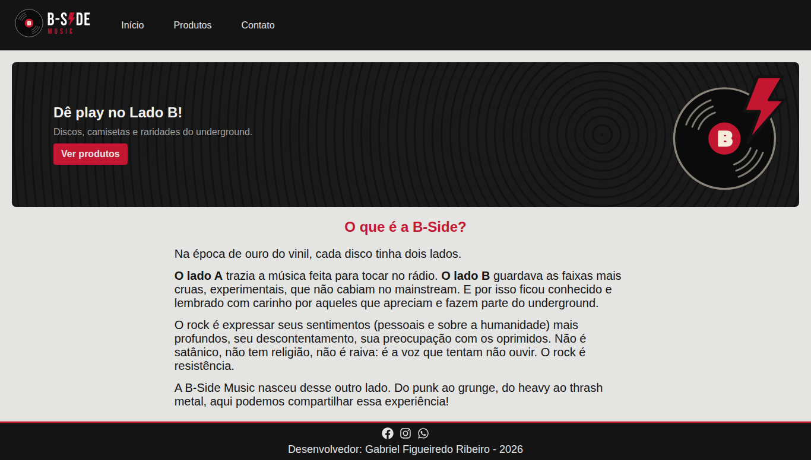

# B-Side Music

Loja virtual fictícia de rock — discos de vinil e camisetas de bandas — desenvolvida em **React** para a atividade **"Criação de site com React"** do curso de Desenvolvimento de Software Multiplataforma da **Fatec Cotia**.

O nome é um trocadilho duplo: o **lado B** do vinil, onde ficavam as faixas mais cruas e fora do mainstream, e *beside* ("ao lado", em inglês) — a música que está sempre do seu lado.

**Site no ar:** https://b-side-music.vercel.app



---

## Requisitos da atividade

| Requisito | Onde está |
|---|---|
| Header com nome da loja e menu (Início, Produtos, Contato) | `Header` |
| Banner com chamada e fundo | `Banner` |
| Lista com 6 ou mais produtos (nome, imagem, preço e botão "Comprar") | página `Products` — 12 produtos |
| Componente reutilizável `CardProduto` | `CardProduto`, usado 12 vezes |
| Seção Sobre | `About` |
| Footer com nome do aluno, ano e redes sociais | `Footer` |
| Hospedagem na Vercel | https://b-side-music.vercel.app |

---

## Tecnologias

- **React 19** — biblioteca de interface baseada em componentes
- **Vite** — ferramenta de desenvolvimento e build
- **React Router DOM 7** — navegação entre páginas sem recarregar o site
- **React Icons** — ícones (redes sociais, contato)
- **CSS puro** — com variáveis em `:root` para a paleta de cores
- **Vercel** — hospedagem com deploy automático a cada push na branch `v1`

---

## Estrutura do projeto

```
src/
├── App.jsx              → monta o layout (Header, rotas, Footer)
├── main.jsx             → ponto de entrada do React
├── index.css            → variáveis de cor e estilos globais
├── components/
│   ├── Header.jsx       → logo + menu de navegação
│   ├── Banner.jsx       → chamada principal da Home
│   ├── About.jsx        → seção "O que é a B-Side?"
│   ├── CardProduto.jsx  → card reutilizável de produto
│   ├── CardContato.jsx  → card reutilizável de contato
│   ├── BannerGarantia.jsx → garantias da loja (página Contato)
│   └── Footer.jsx       → redes sociais, autor e ano
├── pages/
│   ├── Home.jsx         → Banner + About
│   ├── Products.jsx     → vitrine com os 12 produtos
│   └── Contact.jsx      → canais de contato + garantias
└── data/
    └── produtos.js      → lista de produtos (os dados ficam separados da interface)
```

Cada componente tem seu próprio arquivo `.css` ao lado do `.jsx`.

---

## Componentes

### `Header`
Exibe o logo (que também leva de volta à página inicial) e o menu com **Início**, **Produtos** e **Contato**. Os links usam o `Link` do React Router, que troca a página sem recarregar o site.

### `Banner`
Primeira coisa que o visitante vê na Home: a chamada **"Dê play no Lado B!"**, um texto de apoio e o botão **Ver produtos**, que leva para a vitrine. O fundo imita os sulcos de um disco de vinil e foi feito em CSS com `repeating-radial-gradient`.

### `About`
Seção **"O que é a B-Side?"**: explica a origem do nome (lado A × lado B do vinil) e o que o rock representa para a loja.

### `CardProduto` (reutilizável)
Mostra um produto: imagem, categoria e gênero, nome, banda, preço e botão **Comprar**.

Recebe os dados por **props**:

| Prop | Exemplo |
|---|---|
| `nome` | `"Vinil Nevermind"` |
| `banda` | `"Nirvana"` |
| `preco` | `249.90` |
| `genero` | `"Grunge"` |
| `categoria` | `"Vinil"` |
| `imagem` | `"/produtos/vinil-nevermind.jpg"` |

O preço chega como número e é formatado em reais (R$ 249,90) com `toLocaleString`. O componente é um só: a página `Products` percorre a lista de `produtos.js` com `.map()` e gera um card para cada item. Para adicionar um produto, basta incluir mais um objeto na lista — nenhum card precisa ser escrito à mão.

### `CardContato` (reutilizável)
Mostra um canal de atendimento: ícone, título e texto. Usado 4 vezes na página Contato (E-mail, WhatsApp, Endereço e Funcionamento).

| Prop | Exemplo |
|---|---|
| `icone` | `<FaEnvelope />` |
| `titulo` | `"E-mail"` |
| `texto` | `"B.Side.Vinil@outlook.com"` |
| `link` *(opcional)* | `"mailto:B.Side.Vinil@outlook.com"` |

Usa **renderização condicional**: se recebe um `link`, o texto vira um link clicável; se não recebe (Endereço e Funcionamento), vira um parágrafo comum. Links para sites (`http`) abrem em uma nova aba, para o visitante não sair da loja.

### `BannerGarantia`
Bloco lateral da página Contato com as garantias da loja: troca, compra segura, SAC via WhatsApp, embalagem reforçada para vinil e atendimento híbrido.

### `Footer`
Links para as redes sociais (Facebook, Instagram e WhatsApp), nome do desenvolvedor com link para o LinkedIn e o ano atual, calculado automaticamente com `new Date().getFullYear()`.

---

## Páginas e rotas

| Rota | Página | Conteúdo |
|---|---|---|
| `/` | `Home` | Banner + Sobre |
| `/produtos` | `Products` | Vitrine com os 12 produtos |
| `/contato` | `Contato` | Canais de contato + garantias |

O arquivo `vercel.json` redireciona todas as rotas para o `index.html`, para que o acesso direto (ou o F5) em `/produtos` e `/contato` funcione na Vercel.

---

## Branches

| Branch | Uso |
|---|---|
| `v1` | versão entregue, publicada na Vercel |
| `dev` | desenvolvimento |
| `v2` | próxima versão (banco de dados, área administrativa, carrinho) |

---

## Observações

- A **B-Side Music é uma loja fictícia**: e-mail, telefone, endereço e redes sociais são apenas demonstrativos.
- As imagens dos produtos são ilustrações genéricas, sem logos ou artes oficiais das bandas.
- O botão "Comprar" é visual nesta versão; o carrinho está planejado para a v2.

---

## Autor

**Gabriel Figueiredo Ribeiro** — Desenvolvimento de Software Multiplataforma, Fatec Cotia, 2026
[LinkedIn](https://www.linkedin.com/in/figueiredoribeiro)

---

© 2026 Gabriel Figueiredo Ribeiro. Todos os direitos reservados.
Este repositório está público apenas para fins de avaliação acadêmica e portfólio. Não é permitido copiar, modificar ou redistribuir o código sem autorização do autor.
